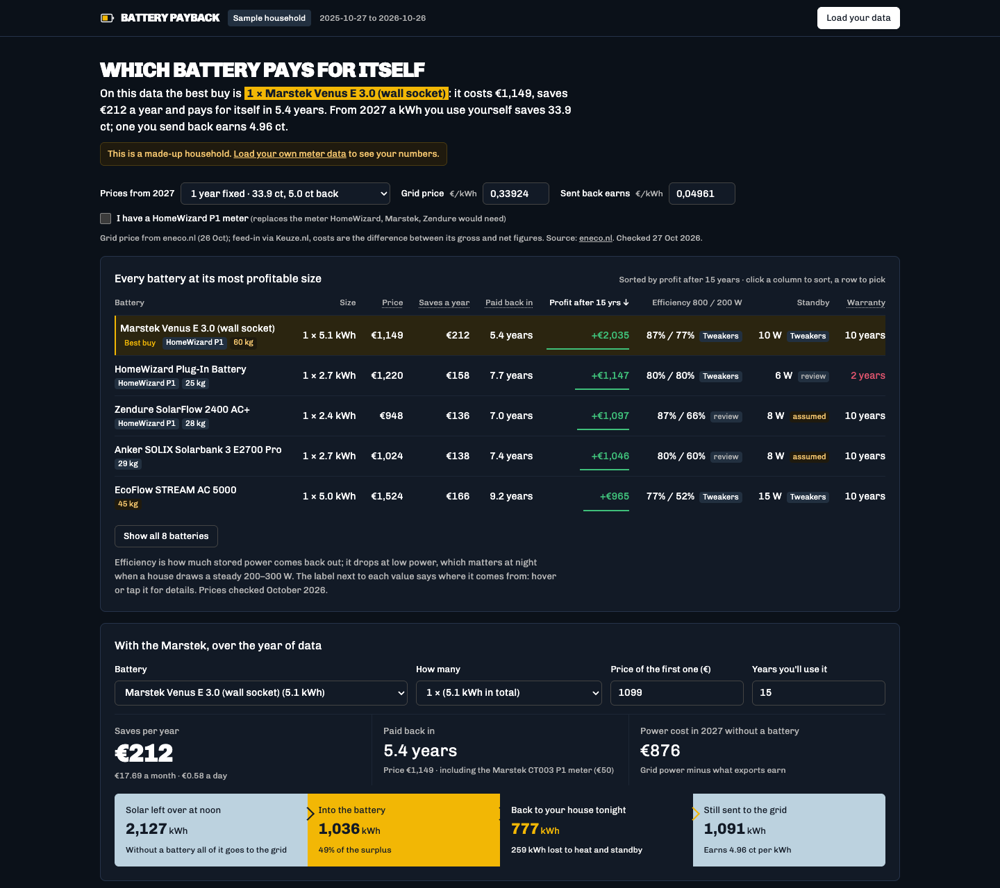

#  Battery payback

**Try it: [battery-payback.larsvanbraam.nl](https://battery-payback.larsvanbraam.nl/)**, or go straight to [the sample household](https://battery-payback.larsvanbraam.nl/sample).

Which home battery pays for itself on your own meter data, once saldering ends in 2027? The page replays a year of hourly grid use and solar surplus through several home batteries (HomeWizard, Marstek, Zendure, Anker, EcoFlow, Sessy), each at every size it comes in, ranks them by profit over their lifetime, and shows what the chosen one saves per year, month and day.

Built with Vite and TypeScript, as a static site with no server code. The only runtime dependency is Vercel Analytics.



## Your data stays in your browser

First-time visitors get a start screen with three choices: fetch their data, upload a file, or explore a made-up sample household (also linkable as `/sample`). Returning visitors go straight to their stored results. The two ways to load your own data:

- **From their energy supplier, with a bookmarklet.** They drag a button to their bookmarks bar, log in to their supplier's site and click the bookmark. The bookmarklet runs there, in their own logged-in browser: it fetches the past year of hourly usage from the supplier's own API, opens this site in a new tab and hands the data over with `postMessage`. If that tab can't be reached (a popup blocker, for example), the data downloads as a CSV to upload instead. This site's server never sees a login or a meter reading, and the supplier only sees the same requests its own site makes. Clicking the bookmark again later fetches only the new days.
- **By uploading a CSV** with `timestamp,import_kwh,export_kwh`, one row per hour (ISO timestamps with an offset, for example `2026-06-01T12:00:00+02:00`).

Whatever is loaded is kept in `localStorage`, so the page shows the visitor's own numbers next time. They can download it as CSV or forget it from the "Load your data" dialog.

Supported suppliers: **Greenchoice**. See [Adding a supplier](#adding-a-supplier).

## Develop

```bash
npm install
npm run dev
```

Open http://localhost:5173. In development the supplier list also has a **Demo supplier** that serves the sample household from http://127.0.0.1:5173, a different origin, so you can try the whole bookmarklet flow without an account: drag its button to your bookmarks bar, open http://127.0.0.1:5173 and click the bookmark.

```bash
npm test          # Vitest: simulation, Greenchoice parsing, dataset merging, message validation, routing
npm run typecheck # type-check only
npm run build     # type-check, then build to dist/
npm run preview   # serve the built dist/ locally
npm run sample    # regenerate public/data/sample-hourly.csv
```

Node 22.18 or newer is needed (`engines` in `package.json`).

The share image and icons in `public/` are rendered from `scripts/og/`; [scripts/og/README.md](scripts/og/README.md) has the commands. The screenshot in this README is the live sample page:

```bash
"/Applications/Google Chrome.app/Contents/MacOS/Google Chrome" --headless --hide-scrollbars \
  --window-size=1440,1280 --virtual-time-budget=10000 \
  --screenshot=docs/screenshot.png https://battery-payback.larsvanbraam.nl/sample
```

## Paths

| Path | Shows |
| --- | --- |
| `/` | The start screen, or straight to `/results` when this browser has stored data |
| `/sample` | The results for the made-up sample household |
| `/results` | The results for your stored data |
| `/import/<supplier>` | Where the bookmark opens the tool to hand over your data |

Old links with `#sample` or `#import=<supplier>` are rewritten to these paths. The routing is `src/router.ts`, using the browser's History API.

## What visitors can change on the page

Nothing here is stored except the loaded data; every setting starts from its default on each visit.

| Setting | Default | What it changes |
| --- | --- | --- |
| Prices from 2027 | Eneco, 1 year fixed | Picks a row from `tariffs-2027.csv` |
| Grid price, Sent back earns | From the picked tariff | Overrides the price per kWh bought and the net value per kWh sent back |
| I have a HomeWizard P1 meter | Off | Drops the meter price for batteries with `homewizard_p1` = 1 |
| Ranking sort | Profit | Click Price, Saves a year, Paid back in, Profit or Warranty to sort; Best buy stays the most profitable |
| Battery, How many | HomeWizard, 1 | The battery the rest of the page shows; clicking a ranking row picks it too |
| Price of the first one | From `batteries.csv` | Overrides that battery's price for this visit |
| Years you'll use it | 15 | The lifetime for profit after N years and for what counts as paid back |
| What-if presets and sliders | Realistic | Grid use (−30% to +50%), solar left over (−30% to +30%), grid price change per year (−5% to +8%), battery ageing per year (0–5%) and real-world shortfall (0–20%), for the year-by-year projection only |
| Monthly payment, Welcome discount | €65, €150 | The supplier bill with and without the battery |

## Defaults in the code

| Constant | Where | Value |
| --- | --- | --- |
| `DEFAULT_SCENARIO` | `src/main.ts` | `eneco_1y`, a `scenario` in `tariffs-2027.csv` |
| `DEFAULT_BATTERY` | `src/main.ts` | `homewizard`, an `id` in `batteries.csv` |
| `RANKING_ROWS` | `src/main.ts` | 5 rows shown before "Show all" |
| `HEAVY_KG` | `src/main.ts` | 40 kg, from which the weight label turns amber |
| `WHAT_IF_PRESETS` | `src/main.ts` | The four what-if presets and their slider values |
| `DAYS` | `src/bookmarklet/runtime.ts` | 365 days fetched by the bookmarklet, up to yesterday |
| `KEEP_DAYS` | `src/dataset.ts` | 365 days kept in the browser; older days are dropped |
| `KEY` | `src/dataset.ts` | `home-battery-payback:dataset`, the `localStorage` key |

## Adding a supplier

1. Create `src/providers/<id>/info.ts` with the supplier's `id`, `name`, `origin` (where the bookmarklet runs, for example `https://mijn.greenchoice.nl`) and `loginUrl`.
2. Create `src/providers/<id>/bookmarklet.ts` that calls `runBookmarklet` from `src/bookmarklet/runtime.ts` with a `fetchHours(range, onProgress)` that returns `[timestamp, importKwh, exportKwh]` rows for that supplier. Keep it polite: a few requests at a time, as the supplier's own site would make. `src/providers/greenchoice/` is the reference.
3. Add it to `PROVIDERS` in `src/providers/index.ts`, importing the bookmarklet with the `?bookmarklet` suffix. `plugins/bookmarklet.ts` bundles and minifies it into the link.
4. Add parsing tests with a trimmed real response, like `tests/import.test.ts` does for Greenchoice.

## Layout

| Path | What it is |
| --- | --- |
| `index.html` | Page markup |
| `src/main.ts` | Wires the controls and renders every block |
| `src/simulate.ts` | CSV parsing, battery simulation and cost comparison (no DOM) |
| `src/charts.ts` | Dependency-free SVG charts and tooltips |
| `src/import.ts` | Loading data (sample, upload, bookmarklet handoff, local storage) and which screen shows |
| `src/router.ts` | Paths, Back and Forward, old hash links |
| `src/start.ts` · `src/start.css` | The start screen |
| `src/dataset.ts` | Stored dataset: merge, clean and save |
| `src/bookmarklet/` | Shared bookmarklet runtime and the message protocol with the page |
| `src/providers/` | One folder per supplier, plus the dev-only demo |
| `plugins/bookmarklet.ts` | Vite plugin that turns `?bookmarklet` imports into a minified script string |
| `plugins/site-url.ts` | Vite plugin that fills `%SITE_URL%` in `index.html` for the share links, from the `SITE_URL` environment variable or else the Vercel production domain |
| `public/data/` | Battery specs and prices, 2027 tariff presets, the sample household |
| `scripts/generate-sample.ts` | Generates the sample household |
| `scripts/og/` | Sources of the share image and home-screen icon |
| `docs/screenshot.png` | The screenshot in this README |
| `vercel.json` | Sends every page path to `index.html` |
| `tests/` | Vitest tests |

## Where the data comes from

Every figure was collected by hand from the sources below; nothing is fetched automatically. Prices and tariffs go stale within months, so each file records when it was checked. The page shows the oldest battery `price_checked` under the ranking and each tariff's `checked` date under the price picker.

| Data | Source | Checked |
| --- | --- | --- |
| Battery prices | Tweakers Pricewatch, manufacturers' and retailers' list prices (`price_source`) | `price_checked`: all 27 Oct 2026 |
| Meter prices and HomeWizard P1 support | Manufacturers' and retailers' stores (`meter_source`) | Oct 2026 |
| Efficiency, standby and usable storage | Tweakers lab tests for the Marstek, Anker Max and EcoFlow AC 5000; a year of home use for the HomeWizard; one review each for the Zendure, Anker E2700 Pro and Sessy; assumed for the EcoFlow AC Pro (`*_source`, `review_url`) | Reviews from 2025 and 2026 |
| Size and weight | Spec sheets, manuals and retailer listings (`size_source`) | Aug 2024 to Oct 2026 |
| 2027 tariffs | Suppliers' own sites, feed-in costs via Keuze.nl (`source_url`) | `checked`: 27 Oct 2026 |
| Sample household | Made up by `scripts/generate-sample.ts` | — |

To refresh a figure, change it in the CSV and update its date column.

## Data formats

- **Tariffs** (`public/data/tariffs-2027.csv`): one row per supplier contract: `scenario,supplier,contract,import_eur_kwh,feedin_eur_kwh,feedin_cost_eur_kwh,net_export_eur_kwh,source_url,checked,note`. Grid prices include VAT and energy tax; `net_export_eur_kwh` is what a kWh sent back is worth after feed-in costs, the figure the calculation uses. `feedin_eur_kwh`, `feedin_cost_eur_kwh`, `source_url` and `checked` can be empty, as in the `stress` what-if row. The picker groups rows by `supplier` and shows `note`, the source and `checked` under it.
- **Batteries** (`public/data/batteries.csv`): one row per battery. Add a row to compare another one.
  - **Name:** `id` (unique; `DEFAULT_BATTERY` refers to it), `brand`, `model`.
  - **Specs:** `unit_kwh`, `usable_share`, `charge_kw`, `discharge_kw`, `max_power_kw`, `standby_w`, `rated_cycles`, `warranty_years`.
  - **Efficiency curve:** `rte_200`, `rte_500`, `rte_800`, `rte_max`, the round-trip efficiency at 200 W, 500 W, 800 W and full power, as Tweakers measures it. Leave the low-power columns empty when only an 800 W figure is known; they're then estimated from the average drop Tweakers found.
  - **Combining units:** `power_scales` (1 if each extra unit adds power, 0 if it only adds storage) and `max_units`.
  - **Costs:** `first_unit_eur`, `extra_unit_eur`, `install_eur`, and `price_checked` (YYYY-MM-DD, when the price and meter price were last checked).
  - **Meter:** `meter` (what the battery needs to read the grid meter), `meter_eur` (0 when included), `homewizard_p1` (1 if a HomeWizard P1 meter can stand in for it) and `meter_source`.
  - **Size:** `size_cm` (one unit's outside size, for example `40 × 30 × 20`, in the order the source gives it), `weight_kg` and `size_source`.
  - **Provenance:** `capacity_source`, `efficiency_source` and `standby_source` (`tweakers`, `review`, `manufacturer` or `assumed`; `efficiency_source` can also be `tweakers_home`, a year measured at home, used at every power), `efficiency_by` and `standby_by` (who measured it, for `review`), `price_source`, `review_url`, `notes`.
